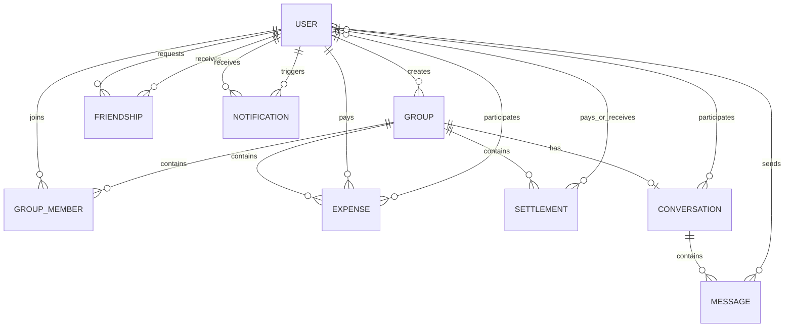

*This project has been created as part of the 42 curriculum by mohel-kh, moel-aid, moelgham, zdidah, sihfadil.*

# Splitify

Splitify is a full-stack web application for managing shared expenses between friends and groups. It helps users organize groups, record shared expenses, calculate balances, settle debts, communicate through group chats, and stay informed through notifications.

The application also includes an AI-powered group assistant that answers questions about a group's financial activity using retrieved group data, as well as an administration interface and monitoring infrastructure.

## Table of Contents

- [Description](#description)
- [Team Information](#team-information)
- [Project Management](#project-management)
- [Technical Stack](#technical-stack)
- [Database Schema](#database-schema)
- [Features List](#features-list)
- [Modules](#modules)
- [Installation and Instructions](#installation-and-instructions)
- [Resources and AI Usage](#resources-and-ai-usage)
- [Individual Contributions](#individual-contributions)
- [Known Limitations](#known-limitations)

## Description

### Project Goal

Managing shared expenses can become difficult when several people share costs over time. Splitify centralizes this process by allowing users to create groups, record expenses, see who owes whom, and register settlements.

The application combines expense management with communication tools so group members can coordinate in the same place.

### Key Features

- Account registration with email verification, and login, including Google OAuth 2.0.
- Two-factor authentication (TOTP authenticator apps) with one-time recovery codes.
- Accessibility work targeting WCAG 2.1 AA: keyboard navigation, screen reader support, and focus management.
- User profiles and avatar management.
- Group creation and member management.
- Shared expenses with equal or custom splits.
- Group balances and settlement tracking.
- Friends and friend requests.
- Persistent group conversations and real-time messaging.
- Real-time notifications.
- An AI assistant for questions about group expenses and settlements.
- An administration panel with user and group management.
- Docker-based deployment, monitoring, health checks, and database backups.

## Team Information

The project was developed by a team of five members.

| Member (42 / Git login) | Assigned role(s) | Main responsibilities |
|---|---|---|
| `mohel-kh` | Backend Developer | Backend API development, group-related workflows, friends, chat, conversations, and notifications. |
| `moel-aid` | Backend Developer, Product Owner (PO) | Backend development, product requirements, feature prioritization, and coordination of the product scope. |
| `moelgham` | AI Developer | AI assistant, retrieval-augmented generation (RAG), data retrieval, embeddings integration, and LLM integration. |
| `zdidah` | Frontend Developer, Tech Lead | React frontend, user interface, frontend/backend integration, and technical coordination. |
| `sihfadil` | DevOps Engineer, Project Manager (PM) | Docker and deployment infrastructure, monitoring, backups, project coordination, and progress follow-up. |

## Project Management

### Work Organization

The team divided the project into areas of responsibility according to each member's role. Members worked on individual Git branches, while `main` was the shared integration branch containing the combined project work.

The team coordinated implementation and integration through regular communication. At the end of each week, the five members held a meeting to:

- Review the progress made during the week.
- Discuss blockers and problems.
- Check which tasks were completed.
- Agree on priorities and work for the following week.

### Tools and Communication

- **Git and GitHub:** Source control, individual branches, and integration through the shared `main` branch.
- **WhatsApp:** A group containing all five members was used for daily communication, questions, and coordination.
- **Weekly team meetings:** Used to review progress and plan the next week's work.

## Technical Stack

### Frontend

| Technology | Purpose |
|---|---|
| React 18 | Component-based user interface. |
| TypeScript | Static typing for frontend code. |
| Vite | Frontend development server and production build tool. |
| React Router | Client-side navigation. |
| Socket.IO Client | Real-time communication with the backend. |
| CSS Modules | Component-level styling. |
| Lucide React | Interface icons. |

### Backend

| Technology | Purpose |
|---|---|
| Node.js 22 | JavaScript runtime. |
| Express 5 | HTTP server, API routes, and middleware. |
| Mongoose 9 | MongoDB object modelling, schemas, and queries. |
| Socket.IO 4 | Real-time, bidirectional communication. |
| Express Session and Connect Mongo | Session-based authentication with sessions stored in MongoDB. |
| Passport and passport-google-oauth20 | Google OAuth 2.0 authentication. |
| bcrypt | Password and recovery-code hashing. |
| otplib and qrcode | TOTP two-factor authentication and the enrolment QR code. |
| Nodemailer | Sends email-verification and password-change emails through Gmail. |
| Multer and Sharp | Image upload handling and image processing. |
| Helmet and express-rate-limit | HTTP security headers and request-rate limiting. |
| prom-client | Exposes backend metrics for Prometheus. |

### Database

**MongoDB 7** is used as the database.

MongoDB was selected because its document model is suitable for the application's related but evolving data, including users, groups, memberships, expenses, invitations, conversations, and notifications. Mongoose provides schema definitions, validation, references between documents, and a structured way to query the database from Node.js.

### AI Components

| Technology | Purpose |
|---|---|
| Groq API | LLM inference and streamed AI responses. |
| Jina AI embeddings API (configurable) | Optional generation of embeddings for semantic retrieval. |
| Custom RAG pipeline | Chunks group data, retrieves relevant information, builds a prompt, and passes it to the LLM. |
| Server-Sent Events (SSE) | Streams generated response fragments and source information to the frontend. |

### DevOps and Infrastructure

| Technology | Purpose |
|---|---|
| Docker and Docker Compose | Containerization and multi-service orchestration. |
| Nginx | Serves the frontend, terminates HTTPS, and proxies requests to the backend. |
| Prometheus | Collects backend metrics and evaluates alerting rules. |
| Grafana | Displays monitoring dashboards. |
| GitHub Actions | Runs automated checks and build jobs. |

### Main Technical Choices

- **React and Express:** Separate frontend and backend responsibilities and communicate through HTTP APIs.
- **MongoDB and Mongoose:** Store application data as documents while defining schemas and references in the backend.
- **Socket.IO:** Support real-time chat and notification delivery without requiring clients to repeatedly poll the server.
- **Session authentication:** Keep the authenticated user associated with a server-side session stored in MongoDB.
- **Docker Compose:** Start the frontend, backend, database, backup service, and monitoring services in a reproducible environment.
- **Prometheus and Grafana:** Collect operational metrics and make backend health and performance easier to observe.
- **RAG:** Retrieve relevant group-specific financial information before asking the language model to generate an answer.

## Database Schema

The application uses MongoDB collections represented by Mongoose models. The main models found in the backend are:

| Collection / Model | Important fields | Relationships and purpose |
|---|---|---|
| `User` | `username`, `email`, `password`, `googleId`, `avatar`, `bio`, `isVerified`, `verificationToken`, `twoFactorEnabled`, `twoFactorSecret`, `twoFactorRecoveryCodes`, `role`, `status`, `joinedAt` | User accounts, profile information, authentication identity, email verification, two-factor settings, and account permissions. The 2FA secret is stored AES-256-GCM encrypted, recovery codes are stored as bcrypt hashes, and both are excluded from queries unless explicitly selected. |
| `Group` | `name`, `kind`, `emoji`, `createdBy`, `members`, `description`, `expenses`, `conversationId`, timestamps | A group has an owner, members, expenses, and an associated conversation. |
| `Friendship` | `requester`, `receiver`, `status`, timestamps | Stores friend requests and their pending, accepted, or rejected state. |
| `Expense` | `group`, `payer`, `participants`, `amount`, `description`, `date`, `splitMethod`, `customSplit` | Stores an expense, the payer, participants, and equal or custom shares. |
| `Settlement` | `group`, `fromUser`, `toUser`, `amount`, `status`, `date` | Records a payment/settlement between group members. |
| `Conversation` | `participants`, timestamps | Stores the users participating in a conversation. Groups reference their conversation through `Group.conversationId`. |
| `Message` | `conversationId`, `senderId`, `content`, timestamps | Stores messages belonging to a conversation and the user who sent each message. |
| `Notification` | `senderId`, `userId`, `type`, `title`, `message`, `relatedId`, `isRead`, timestamps | Stores notifications for a recipient, optionally linked to a related application object. |

### Main Relationships



The diagram is a conceptual view of the main references. In the implementation, group members are embedded subdocuments in the `Group` document, while references to users, groups, conversations, and other documents use MongoDB ObjectIds. `Notification.relatedId` is a generic ObjectId whose target depends on the notification type.

## Features List

The following list describes the main features represented in the current project source.

| Feature | Description | Main contributor(s) |
|---|---|---|
| Authentication | Account registration, password login, session handling, logout, and Google OAuth login. | `moel-aid` |
| Email verification | A verification link is emailed at signup; password login is refused until the address is verified, and the link can be resent (rate-limited). | `moel-aid`, `zdidah` |
| Two-factor authentication | Optional TOTP 2FA from Settings: QR-code enrolment, code confirmation, ten one-time recovery codes, regeneration, and disabling (password + code). When on, both password and Google sign-ins require the second factor. | `zdidah` |
| Accessibility | Skip link, per-route page titles, focus-trapped dialogs that restore focus, keyboard shortcuts, labelled controls, announced errors, visible focus ring, contrast fixes, and reduced-motion support. | `zdidah` |
| Legal pages | Terms of Service and Privacy Policy pages, reachable from the application. | `zdidah` |
| User profiles | View and update profile information, manage avatars, and change passwords. | `moel-aid`, `zdidah` |
| Group management | Create, rename, view, and delete groups; add, remove, or leave group memberships. | `mohel-kh` |
| Expense management | Create expenses and split them equally or through custom participant amounts. | `moel-aid` |
| Balances and settlements | Calculate group balances and record settlements between members. | `moel-aid` |
| Friends | Send, accept, reject, list, and remove friend relationships. | `mohel-kh` |
| Group chat | Persist messages and deliver real-time message events through Socket.IO conversation rooms. | `mohel-kh`, `zdidah` |
| Notifications | Store notifications, expose read/delete operations, and deliver real-time notification events. | `mohel-kh` |
| AI group assistant | Answer questions using authorized group, expense, and settlement data through a RAG pipeline and streamed LLM output. | `moelgham` |
| Administration | Admin routes and interface for inspecting users/groups/statistics and suspending or reactivating user accounts. | `mohel-kh`, `zdidah` |
| Dashboard and navigation | Display groups, balances, recent activity, and application navigation. | `zdidah` |
| Monitoring and operations | Health endpoints, metrics, dashboards, alert rules, automated backups, and restore scripts. | `sihfadil` |

## Modules

The selected modules and their point values are listed below. The total is **21 points**.

| Module | Type | Points | Implementation | Main contributor(s) |
|---|---|---:|---|---|
| Full-stack frameworks | Major | 2 | React and TypeScript frontend connected to a Node.js and Express backend through API endpoints. | `zdidah`, `mohel-kh`, `moel-aid` |
| Real-time communication | Major | 2 | Socket.IO integration over an HTTP server, authenticated socket connections, user-specific and conversation rooms, and real-time message and notification delivery. | `mohel-kh`, `zdidah` |
| User interaction | Major | 2 | User-facing workflows for profiles, groups, members, expenses, balances, settlements, friends, and notifications. | `zdidah`, `mohel-kh`, `moel-aid` |
| RAG (Retrieval-Augmented Generation) | Major | 2 | Group financial data is loaded, split into chunks, retrieved for a question, and added to the LLM prompt. Embeddings can be used for semantic retrieval. | `moelgham` |
| Google OAuth 2.0 | Minor | 1 | Passport Google strategy authenticates users, links an existing account by email, or creates a Google-based account. | Backend team |
| Prometheus / Grafana monitoring | Major | 2 | Backend metrics are exposed for Prometheus; Grafana is provisioned with a backend overview dashboard and Prometheus alert rules. | `sihfadil` |
| Health checks, backups, and disaster recovery | Minor | 1 | Health endpoints and container health checks, scheduled MongoDB backups with retention, manual backup/restore scripts, and a documented recovery procedure. | `sihfadil` |
| Complete notifications | Minor | 1 | Persistent notifications for application events, unread/read state, deletion, clearing, and real-time delivery through Socket.IO. | `mohel-kh`, `moel-aid`, `zdidah` |
| Advanced permissions | Major | 2 | Session authentication, admin-role checks, suspended-account handling, group-owner restrictions, and conversation-participant authorization. | `mohel-kh`, `moel-aid` |
| LLM interface | Major | 2 | Integration with the Groq chat-completions API, streamed model output, cancellation handling, and SSE events for tokens, sources, completion, and errors. | `moelgham` |
| Advanced chat | Minor | 1 | Persistent group conversations and messages, Socket.IO user/conversation rooms, authenticated connections, and real-time message delivery. | `mohel-kh`, `zdidah` |
| Two-Factor Authentication (2FA) | Minor | 1 | TOTP (RFC 6238) via authenticator apps, enrolled by QR code. Secrets are AES-256-GCM encrypted at rest; ten single-use bcrypt-hashed recovery codes; ±1 time-step drift window with replay protection; a 5-minute, 5-attempt login challenge that grants no session until passed; session regeneration after success; strict rate limiting; applies to password and Google sign-ins. | `zdidah` |
| Accessibility (WCAG 2.1 AA) | Minor | 1 | Keyboard navigation (skip link, focus trapping and restoration in every dialog, Escape to close, arrow-key pickers, `N` shortcut exposed with `aria-keyshortcuts`), screen reader support (`lang`, per-route titles, one `h1` per page, labelled controls, `aria-live`/`role="alert"` error announcements, `aria-pressed` toggles, decorative icons hidden), raised text contrast, visible focus ring, inline field errors, `autocomplete` hints, and `prefers-reduced-motion` support. | `zdidah` |
| Secure Avatar Image Processing | Minor (Custom) | 1 | Image upload validation and processing using Multer and Sharp, including resizing, orientation correction, JPEG conversion, metadata removal, file-size restrictions, and rate limiting. | `moel-aid`, `zdidah` |
| **Total** | **7 Major + 7 Minor (including 1 Custom Minor)** | **21** | | |

### Module Point Calculation

- Major modules: 7 × 2 = 14 points.
- Standard Minor modules: 6 × 1 = 6 points.
- Custom Minor module: 1 × 1 = 1 point.
- **Total: 14 + 6 + 1 = 21 points.**

## Installation and Instructions

The recommended way to run the complete application is with Docker Compose.

### Prerequisites

Install the following tools:

- Git.
- Docker Engine.
- Docker Compose plugin (the `docker compose` command).
- A web browser.

The application containers use Node.js 22, MongoDB 7, and the service versions declared in `docker-compose.yml` and the Dockerfiles. OpenSSL is useful for generating a secure session secret.

### 1. Clone the Repository

```bash
git clone https://github.com/itsameed/ft_transcendence.git
cd ft_transcendence
```

### 2. Configure Environment Variables

Create your local environment file:

```bash
cp .env.example .env
```

Generate a session secret:

```bash
openssl rand -hex 32
```

Put the generated value in `SESSION_SECRET` in `.env`.

Set the MongoDB and Grafana credentials:

```env
MONGO_INITDB_ROOT_USERNAME=your_mongodb_username
MONGO_INITDB_ROOT_PASSWORD=your_mongodb_password

GF_SECURITY_ADMIN_USER=your_grafana_username
GF_SECURITY_ADMIN_PASSWORD=your_grafana_password
```

Configure the Gmail account used to send verification emails. New accounts must verify their email before they can sign in with a password, so this is required for signup. Use a Google [app password](https://support.google.com/accounts/answer/185833), not the account password:

```env
GMAIL_USER=your_gmail_address
GMAIL_APP_PASS=your_gmail_app_password
```

The Docker Compose configuration builds `MONGO_URL` for the backend from the MongoDB credentials and sets `FRONTEND_URL` to `https://localhost:8443`. The application container uses port `3000`.

#### Optional integrations

To enable the AI assistant, configure a Groq API key:

```env
GROQ_API_KEY=your_groq_api_key
```

Semantic embeddings are optional. The repository's example configuration uses Jina AI:

```env
EMBEDDINGS_API_KEY=your_jina_api_key
EMBEDDINGS_BASE_URL=api.jina.ai
EMBEDDINGS_MODEL=jina-embeddings-v3
EMBEDDINGS_PATH=/v1/embeddings
```

To enable Google OAuth, configure the Google client credentials and make sure the callback URL registered with Google matches the application's callback route:

```env
GOOGLE_CLIENT_ID=your_google_client_id
GOOGLE_CLIENT_SECRET=your_google_client_secret
GOOGLE_CALLBACK_URL=https://localhost:8443/auth/google/callback
```

To enable two-factor authentication, set a 64-character hex key used to encrypt TOTP secrets. Without it, the Settings page reports 2FA as unavailable:

```bash
openssl rand -hex 32
```

```env
TWOFA_ENC_KEY=the_generated_value
```

Keep this key stable: changing or losing it makes existing 2FA secrets unreadable, and affected users would have to sign in with a recovery code.

Do not commit `.env` or place real credentials in `.env.example`.

### 3. Build and Start the Application

Run:

```bash
docker compose up -d --build
```

Alternatively, use the Makefile:

```bash
make start
```

Check the services:

```bash
docker compose ps
```

### 4. Open the Application

| Service | Local URL |
|---|---|
| Splitify application | [https://localhost:8443](https://localhost:8443) |
| Grafana | [http://localhost:3001](http://localhost:3001) |
| Prometheus | [http://localhost:9090](http://localhost:9090) |

The local HTTPS certificate is self-signed. Your browser may display a security warning during local development.

### 5. Verify the Backend

Check the application health endpoint:

```bash
curl -k https://localhost:8443/health
```

A successful response is:

```json
{
  "status": "ok"
}
```

Check the running containers and logs:

```bash
docker compose ps
docker compose logs -f
```

### 6. Useful Commands

| Command | Description |
|---|---|
| `make help` | Display available Makefile commands. |
| `make start` | Build and start all services. |
| `make up` | Start services using existing images. |
| `make down` | Stop services while preserving named volumes. |
| `make build` | Build service images. |
| `make rebuild` | Rebuild images without cache and start services. |
| `make restart` | Restart services. |
| `make logs` | Follow service logs. |
| `make ps` | Show service status. |
| `make backup` | Create a manual MongoDB backup. |
| `make restore FILE=<path>` | Restore a selected backup. |
| `make reset` | Remove containers and volumes after confirmation. |

**Warning:** `make reset` removes Docker volumes and therefore deletes persisted local database and service data. Use it only when a full reset is intended.

### Database Backup and Restore

Automatic backups are handled by the `db-backup` container. A backup is created when the service starts and then every 24 hours. Backups older than seven days are removed automatically.

To create a manual backup:

```bash
make backup
```

To restore a backup:

```bash
make restore FILE=database-backups/<backup-file>
```

The restore script uses `mongorestore --drop`, which replaces the current database collections with the selected backup. Stop application writes and verify the selected backup before restoring.

## Resources and AI Usage

### Technical References

- [React Documentation](https://react.dev/learn)
- [TypeScript Documentation](https://www.typescriptlang.org/docs/)
- [Vite Documentation](https://vite.dev/guide/)
- [Node.js Documentation](https://nodejs.org/docs/latest/api/)
- [Express Documentation](https://expressjs.com/)
- [MongoDB Documentation](https://www.mongodb.com/docs/)
- [Mongoose Documentation](https://mongoosejs.com/docs/)
- [Socket.IO Documentation](https://socket.io/docs/v4/)
- [Passport.js Documentation](https://www.passportjs.org/)
- [Google OAuth 2.0 Documentation](https://developers.google.com/identity/protocols/oauth2)
- [Docker Documentation](https://docs.docker.com/)
- [Nginx Documentation](https://nginx.org/en/docs/)
- [Prometheus Documentation](https://prometheus.io/docs/)
- [Grafana Documentation](https://grafana.com/docs/)
- [Groq API Documentation](https://console.groq.com/docs)
- [Jina AI Documentation](https://jina.ai/)

### AI Usage During Development

AI tools, including ChatGPT, were used as development assistance during the project. They supported the team with tasks such as:

- Explaining technical concepts and framework behavior.
- Helping investigate errors and debugging problems.
- Discussing implementation approaches and architecture.
- Reviewing code ideas and suggesting improvements.
- Helping prepare and organize technical documentation.

AI assistance was used as a support tool, not as a replacement for the team's development work. Team members were responsible for integrating, reviewing, testing, and understanding the code used in the project.

### AI-Powered Feature Inside Splitify

The AI assistant is also a feature of the application; this is separate from the use of AI tools during development.

The group assistant retrieves authorized group information, including group members, expenses, and settlements. The RAG pipeline prepares relevant context for the LLM. The backend then streams generated text and source information to the frontend using Server-Sent Events (SSE).

The AI assistant uses the Groq API for language-model inference. Jina AI embeddings can be configured for semantic retrieval; the embeddings integration is optional in the environment configuration.

## Individual Contributions

### `mohel-kh` — Backend Developer

- Worked on backend API functionality for groups and related workflows.
- Implemented and developed friend-request functionality.
- Worked on conversations, persistent messages, and Socket.IO chat behavior.
- Worked on notification creation and delivery for application events.
- Contributed to backend integration between groups, conversations, friends, and notifications.

### `moel-aid` — Backend Developer and Product Owner

- Contributed to backend development and integration.
- Worked on core application workflows and backend functionality alongside the other backend developer.
- Helped define and prioritize product requirements as Product Owner.
- Coordinated feature scope and helped the team align implementation with the project's goals.

### `moelgham` — AI Developer

- Worked on the AI assistant for group financial information.
- Implemented or integrated the RAG processing flow, including data preparation, chunking, retrieval, and prompt construction.
- Worked on the embeddings integration and LLM communication.
- Implemented streamed AI responses and source information for the frontend.

### `zdidah` — Frontend Developer and Tech Lead

- Developed the React and TypeScript frontend.
- Built application pages, reusable components, navigation, and responsive interface elements.
- Integrated frontend screens with backend APIs and real-time functionality.
- Implemented two-factor authentication end to end: TOTP service, encrypted secret storage, recovery codes, login challenge, and the Settings and login UI.
- Led the accessibility pass (WCAG 2.1 AA): keyboard navigation, focus management, screen reader semantics, contrast, and the shared accessible confirmation dialog.
- Built the email-verification page and the login flow for unverified accounts.
- Supported technical coordination and frontend architecture as Tech Lead.

### `sihfadil` — DevOps Engineer and Project Manager

- Worked on the Docker-based project environment and service orchestration.
- Worked on Nginx configuration, HTTPS access, and service integration.
- Set up or maintained Prometheus metrics collection and Grafana monitoring.
- Worked on health checks, database backup and restore procedures.
- Coordinated project progress and followed up on tasks and weekly milestones as Project Manager.

### Challenges and How the Team Addressed Them

| Area | Challenge | Approach used |
|---|---|---|
| Backend | Keeping group, user, expense, conversation, and notification data consistent while enforcing access rules. | Used Mongoose references and backend authorization checks; Socket.IO room joins also verify conversation membership. |
| AI assistant | Producing answers grounded in the correct group's financial data rather than unrelated application data. | The backend checks access to the requested group, loads its relevant data, and passes retrieved context to the RAG pipeline. |
| AI streaming | Returning a response progressively while still delivering sources and completion/error events. | The backend streams token, sources, done, and error events through Server-Sent Events. |
| Frontend | Connecting multiple pages and interactive components to authenticated APIs and real-time events. | The frontend is organized into React pages and reusable components and integrates with the backend API and Socket.IO client. |
| DevOps | Starting several dependent services consistently and recovering data after database loss. | Docker Compose health checks and service dependencies coordinate startup; scheduled and manual backup/restore scripts support recovery. |
| Project coordination | Keeping five members aligned while work was happening on separate branches. | The team used a shared `main` branch, a WhatsApp group, and weekly progress meetings to review work and plan the next steps. |

## Known Limitations

- Google OAuth requires valid Google OAuth credentials and a correctly registered callback URL.
- Password signup requires working Gmail credentials (`GMAIL_USER`, `GMAIL_APP_PASS`), because accounts cannot sign in with a password until their email is verified.
- Two-factor authentication requires `TWOFA_ENC_KEY`. Rotating that key invalidates existing 2FA secrets.
- No automated accessibility checks (such as axe) run in CI, so WCAG 2.1 AA conformance relies on the implementation and manual review.
- The AI assistant requires a valid Groq API key. Semantic retrieval additionally requires a configured embeddings provider; without it, the application uses the available non-semantic retrieval path.
- AI answers depend on the information retrieved from the selected group and on the availability and output of the external LLM provider.
- The local HTTPS certificate is self-signed and may trigger a browser warning.
- Restoring a database backup replaces the current collections because the restore command uses `--drop`.
- The current GitHub Actions workflow checks frontend TypeScript, backend JavaScript syntax, the frontend production build, Docker Compose configuration, and application image builds. A dedicated automated unit-test suite is not defined in the package scripts.

---

**Splitify — 42 ft_transcendence**
